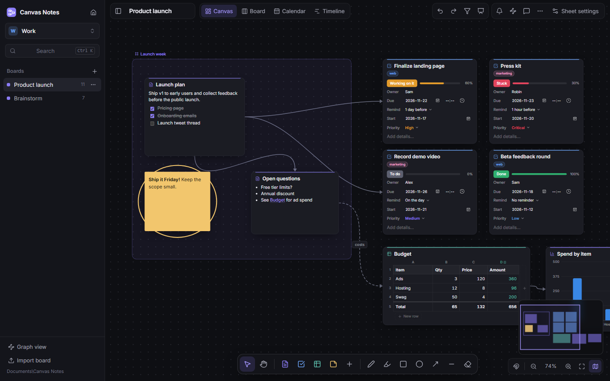
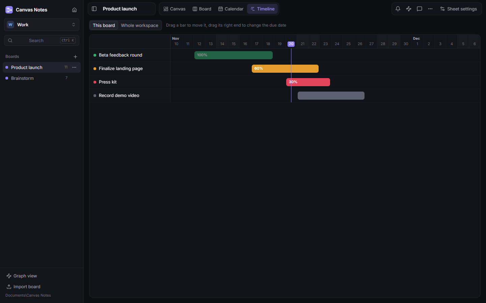
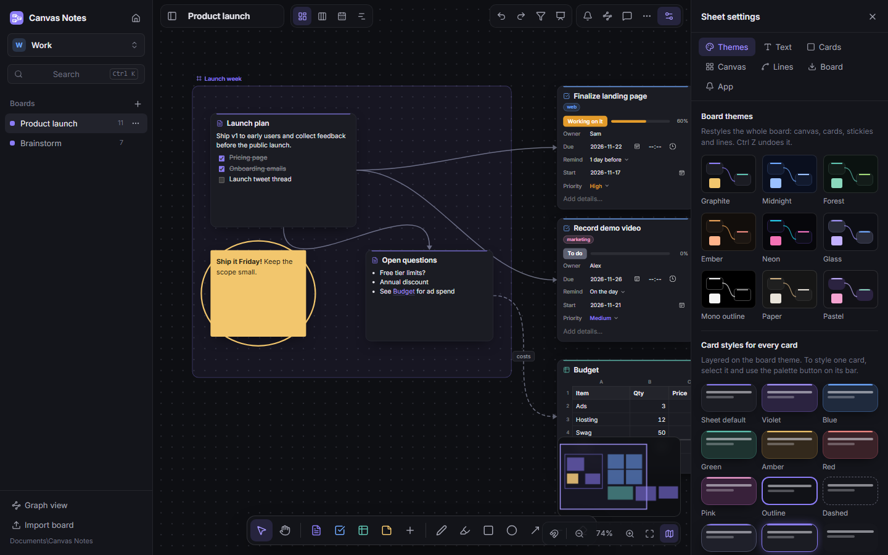
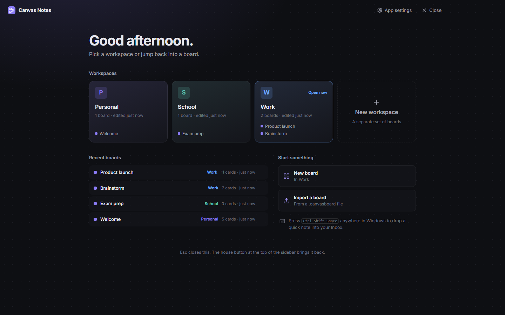

<p align="center"></p>

<h1 align="center">Canvas Notes</h1>

<p align="center">A 2D brainstorming workspace for Windows: infinite canvas boards with cards, connectors, drawing, tables, charts, task boards, mind maps, daily notes, reminders and workspaces, plus an AI assistant that runs on the AI tools you already use. Built with Tauri 2 (Rust) + React.</p>



## Download

Grab the latest version from [Releases](https://github.com/jebster33/canvas-notes/releases/latest):

- **`CanvasNotes-portable.exe`**: a single file, no install. Put it anywhere and run it.
- **`Canvas.Notes_x.y.z_x64-setup.exe`**: a normal installer with a Start menu entry.

The app can update itself from GitHub Releases (App settings → Updates). Turn on **Update automatically** to install new versions when the app starts.

## Screenshots

| | |
| --- | --- |
|  |  |
| **Board view**: your own lists, drag tasks between them | **Task detail**: everything about a task, with Go to canvas |
|  |  |
| **Timeline**: drag bars to reschedule | **Graph**: how cards and boards link together |
|  |  |
| **Themes and sheet settings** for the whole board | **Start menu** with workspaces and recent boards |

## Build it yourself

```powershell
npm install
npm run app        # dev window with hot reload
npm run release    # builds the app into src-tauri/target/release (and an installer in bundle/nsis)
npm run dev        # browser-only preview at http://localhost:1420 (uses browser storage)
```

Screenshots are made by `node scripts/screenshots.mjs` (with `npm run dev` running): it builds a demo workspace in a hidden Edge window and saves `docs/screenshots/*.png`.

## Where your notes live

A vault folder, `Documents\Canvas Notes` by default (change it in the sidebar or Sheet settings → Board):

- `boards/<id>.json`: one file per board
- `assets/`: images, attached files and voice notes
- `.history/<board>/`: automatic snapshots for version history (every 10 minutes, last 60 kept)

**Export board** (Sheet settings → Board, or a board's menu in the sidebar) writes one `.canvasboard` file with every card, line, drawing, comment, image and the board's settings. **Import board** adds it back as a new board. **Export / Import settings only** moves just the look (`.canvastheme`).

## Cards

| Card | Key | What it holds |
| --- | --- | --- |
| Note | N | Rich text: headings, lists, checklists, colors, highlights, `[[wiki links]]` |
| Task | T | Status, progress, owner, due date and time, reminder, start date, priority, details |
| Table | B | Spreadsheet grid. `=SUM(B2:B5)`, `AVG`, `MIN`, `MAX`, `COUNT`, `ROUND`, `ABS`, `IF`, `+ - * / ^` |
| Image | I | Paste (Ctrl V), drag in, or choose a picture |
| Sticky | S | Quick colored note |
| Board link | K | Jumps to another board |
| Frame | F | Named area that groups cards; drag its name tag to move everything inside; present with F5 |
| Chart | C | Bar, line or donut chart fed live from a table card |
| Web link | W | Page preview (title, image, description); YouTube links play inline. Paste or drop a link too |
| Code | X | Code with color highlighting (Lua, Python, JS/TS, Rust, C#, …) |
| File | U | Any attachment; opens in its Windows app, PDFs preview inside the card |
| Voice note | Y | Record from your mic and play back; dropped audio files become voice notes |

### Tables

- **+ at the right edge** (or **Add column…**) asks what you want: text, numbers, checkboxes, or a column calculated from others (add up, subtract, multiply, divide, percentage, share of total, average, highest, lowest). Pick the columns, name it, done. Calculated columns update by themselves.
- **New row** adds a row above any totals. **Add row…** also offers Total, Average, Highest, Lowest and Count rows.
- **Right-click a box**: calculate this box (pick the boxes to use by clicking them), box color, row color, insert or delete rows and columns.
- **Checkboxes** adds a tick box at the start of every row; ticked rows fade out.
- Drag the edge of a column letter to resize it. Typing `=` still works for hand-written formulas.

### Tasks, views and reminders

- **Board / Calendar / Timeline** (top bar) show the board's tasks Trello-style, on a month calendar, or as bars on a timeline. Switch to **All boards** to see every task.
- On **Board**, add your own lists (**Add another list**), double-click a list name to rename it, and use its ⋯ menu for color, order, delete and "count as done". Drag tasks between lists, or drag a list's header to reorder.
- Click any task in those views to open its **detail card**: edit everything, add tags and comments, or press **Go to canvas**.
- **Reminders**: each task picks when to remind you. You get a Windows notification plus an entry under the bell, and a nudge when it's overdue. Settings live in Sheet settings → App.
- Closing the window keeps the app in the **system tray** so reminders and quick capture keep working (quit from the tray icon). Optionally start with Windows.

### More

- **Quick capture**: press **Ctrl Shift Space** anywhere in Windows to jot a note or task into the Inbox board (change the shortcut in Sheet settings → App).
- **Tags**: tag cards from their toolbar; filter the board by tag from the top bar.
- **Align / arrange**: select several cards for align, even spacing and tidy grid.
- **Minimap** (button by the zoom controls), **Export as image or PDF** and **Version history** (⋯ menu in the top bar).

- **Slash commands**: type `/` in any note for headings, lists, checklists, quotes, code, a divider, today's date or a `[[link]]`.
- **Links panel** (chain icon in the top bar): everything that links to the selected card or board, and everything it links to: lines, `[[mentions]]` and board-link cards.
- **Find and replace** (**Ctrl F** / **Ctrl H**): searches every card on the board, with match case, whole word and regex. Arrows jump between hits.
- **Mind maps**: select a card and press **Tab** to branch off a new idea, **Ctrl Enter** for a sibling. The tree lays itself out.
- **Templates**: new boards can start from a template (weekly plan, roadmap, study notes, mood board, mind map, meeting). Save your own boards or groups of cards as templates too.
- **Daily note** (**Ctrl Shift D**, or *Today's note* in the sidebar): one note per day on a Journal board, laid out as a calendar, with the tasks due today already listed.
- **Focus timer**: the timer button on a task starts a 25 minute focus session with breaks. Time spent is logged on the task.
- **Calendar export**: save open tasks as an `.ics` file for Outlook, Google or Apple Calendar, with their reminders (⋯ menu, board menu or the Calendar view).
- **Markdown**: export a board as Markdown, import `.md` files as notes, or paste Markdown straight onto the canvas.
- **Share as web page**: save a board as one read-only HTML file anyone can open in a browser (pan and zoom included, nothing editable).
- **Smarter lines**: elbow lines route around other cards. Select a line and drag the small dots to bend it.
- **Card covers and icons**: give any card an emoji and a color, gradient or image banner (smiley button on the card bar).
- **Light theme and your own fonts**: App settings → Appearance switches the app to light, dark or system and adds your own `.ttf` / `.otf` / `.woff` fonts. The *Daylight* and *Notebook* board looks are light too.
- **Crash-proof cards**: if one card fails to draw, it shows a placeholder instead of taking the board down. Big boards only draw the cards on screen.

Comments live in the right-hand Comments panel; cards with comments show a count badge.

## AI assistant (no API keys)

The assistant (sparkle icon in the top bar, or **Ctrl J**) runs an AI command-line tool that's already installed and signed in on your computer, so it uses the subscription you already have and Canvas Notes never sees a key:

| Tool | Command it runs |
| --- | --- |
| [Claude Code](https://docs.anthropic.com/en/docs/claude-code) | `claude -p` (file and shell tools turned off) |
| [Codex](https://github.com/openai/codex) | `codex exec --sandbox read-only` |
| [Gemini CLI](https://github.com/google-gemini/gemini-cli) | `gemini` |
| [Grok CLI](https://github.com/superagent-ai/grok-cli) | `grok -p` |

Pick a quick action (summarize, brainstorm ideas, make tasks, mind map, or ask anything) for the selected cards or the whole board. Answers can be added as connected cards or a note in one click. The prompt goes to the tool over standard input, never on the command line. You can set a model per tool in the panel.

**Use your boards from the terminal too:** the [`canvas-notes` skill](skills/canvas-notes/SKILL.md) explains the vault format to AI agents. The app copies it into your vault's `.ai` folder as `AGENTS.md` (Codex), `CLAUDE.md` plus a Claude Code skill, `GEMINI.md` and `GROK.md`. Start your tool in that folder, or copy `skills/canvas-notes` into `~/.claude/skills/` to use it everywhere.

## Sync with your own server (preview)

There's no Canvas Notes cloud. To use your boards on several computers, host the tiny sync server in [`server/`](server) yourself, on Netlify, Docker or any machine with Node, then connect to it in **App settings → Sync**. Two computers changing the same board get a choice instead of a silent overwrite.

[](https://app.netlify.com/start/deploy?repository=https://github.com/jebster33/canvas-notes)

Setup steps, Docker and Node commands and the API are in [docs/SYNC.md](docs/SYNC.md). Upload and download are manual for now; automatic sync and live editing together are planned on top of the same server.

## Styling

- **On the card:** select it and use the bar above it (font, size, bold/italic/underline, alignment, text, fill, accent and border colors). While editing text, the bar switches to formatting the selected words.
- **Sheet settings:** fonts, sizes, colors, radius, shadow for all cards or one card type, plus canvas background/grid, default line style and wheel behavior.
- Cards styled by hand show a small violet dot. Click it (or "Apply settings to all cards") to go back to the sheet settings.

## Shortcuts

| Action | Keys |
| --- | --- |
| Search everything | Ctrl K |
| Find / replace on the board | Ctrl F / Ctrl H |
| Today's daily note | Ctrl Shift D |
| AI assistant | Ctrl J |
| Mind map: new branch / sibling | Tab / Ctrl Enter |
| Slash commands in a note | / |
| Graph view | Ctrl G |
| Sheet settings | Ctrl , |
| Toggle sidebar | Ctrl \ |
| Select / Pan | V / H (or hold Space) |
| Pen, highlighter, rectangle, ellipse, arrow, line, eraser | P, M, R, O, A, L, E |
| Edit selected card | Enter or double-click |
| Move around | Left-drag empty canvas (or middle mouse / Space + drag) |
| Make a card in a box | Right-drag over empty canvas, let go, pick a card type |
| Select several | Right-drag (or Shift + left-drag) a box over cards and drawings |
| Add a card anywhere | Double-click or right-click empty canvas |
| Connect cards | Drag a dot on a card edge to another card; drop on empty space to create a connected card |
| Snap to grid on/off | G (or the magnet by the zoom controls) |
| Present frames | F5 (arrows to move, Esc to stop) |
| Undo / Redo | Ctrl Z / Ctrl Y |
| Duplicate, copy, paste | Ctrl D, Ctrl C, Ctrl V |
| Zoom | Wheel (or Ctrl + wheel), Ctrl + / Ctrl -, Ctrl 0, Shift 1 to fit |
| Delete | Delete |

## License

MIT, see [LICENSE](LICENSE).
